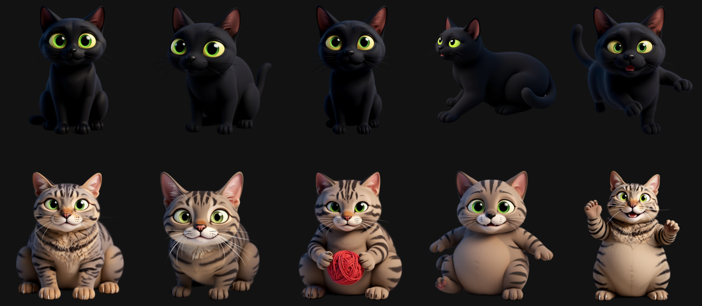

# Frito and Ramona

The two cats on every page of the app are the real ones. They started as the "Blip and Bolt" monsters from the
web app, redrawn in Compose; then as hand-coded cute cats; then as a Stray-style neon pass. All three were
rejected as "too basic", rightly. What finally worked: generate real illustrations of the actual cats from
photos, on the same GPU machine that transcribes the meetings, and animate the sprites.



## How

1. **FLUX.1 Kontext** (the dev model, fp8) through ComfyUI, on an RTX A2000 12 GB. Kontext edits from a reference
   image, so each pose starts from the photo that is closest to it: Frito standing, in profile on the balcony,
   asleep; Ramona loafing on the pouffe, looking up, at her yarn, belly-up on the bed. About two and a half minutes
   per 1024 × 1024 render.
2. **One prompt per pose** (`gen.py`): a style sentence ("cute Pixar-style 3D animated character render of the same
   cat, big glossy eyes, soft fur, plain flat light grey background"), a description of the cat, and the pose.
3. **Variants by editing the render**, not the photo: "close the cat's eyes, keep everything else exactly the same"
   gives the blink frame, "open the mouth in a small meow" the talking frame. The app crossfades to them.
4. **Cutouts** with `rembg` (isnet), trimmed, 23 PNGs, 7 MB, into `app/src/main/assets/cats/`.
5. **In the app**, `Cats.kt` picks one render per mood, adds breathing and bobbing, a 130 ms blink every few seconds,
   the meow frames while talking, and draws the props over them: speech and thought bubbles, the sound bars, the
   yarn, the feather toy on its string. If the assets are missing it falls back to the hand-drawn cats.

## What the prompts had to say, and why

- **Body type, explicitly.** Kontext happily swapped the builds: Frito came out plump, Ramona slim. The prompts now
  say "big, fit, athletic, long-bodied, definitely not fat" and "very fat, round, heavy, with a big belly".
- **Colour, in the negative too.** Ramona rendered orange on the first try. "Grey-brown" alone pushed her grey.
  What held: "grizzled grey-brown salt-and-pepper ticked fur, each hair banded black and tan, absolutely not orange
  and not reddish".
- **Poses from the nearest photo.** Frito curled up from the box photo became a blob; "stretched out on his side"
  from the profile photo worked.
- **Some edits redraw the whole cat.** The blink edit of the play-bow pose kept redrawing Ramona thin, so that pose
  has no blink. The sleep "blink" needed "both eyes completely shut, no eye visible, just closed eyelids" or the
  model left a slit.

## Running it again

```bash
bash setup_comfy.sh        # ComfyUI + venv + rembg into ~/.local/opt/ComfyUI
bash download_models.sh    # FLUX.1 Kontext dev fp8, text encoders, VAE: ~17 GB into ~/cats-art/models
bash start_comfy.sh        # the server on 127.0.0.1:8188
~/.local/opt/ComfyUI/venv/bin/python gen.py all   # poses, then variants, then cutouts
```

`gen.py` expects the reference photos in `refs/` next to it; they are not in the repo. The GPU is shared with
transcription, so this is a night job. The model's licence is non-commercial, which is fine for cats.

The earlier hand-drawn versions are kept for the record: `Cats.kt` still carries the vector cats as the fallback,
and `android/docs/cats-preview.html` renders them in a browser (`?style=stray` for the neon pass).
